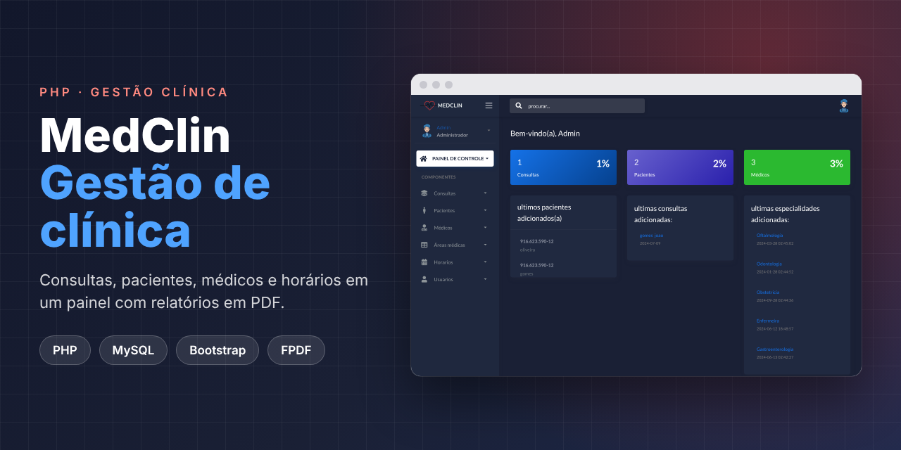
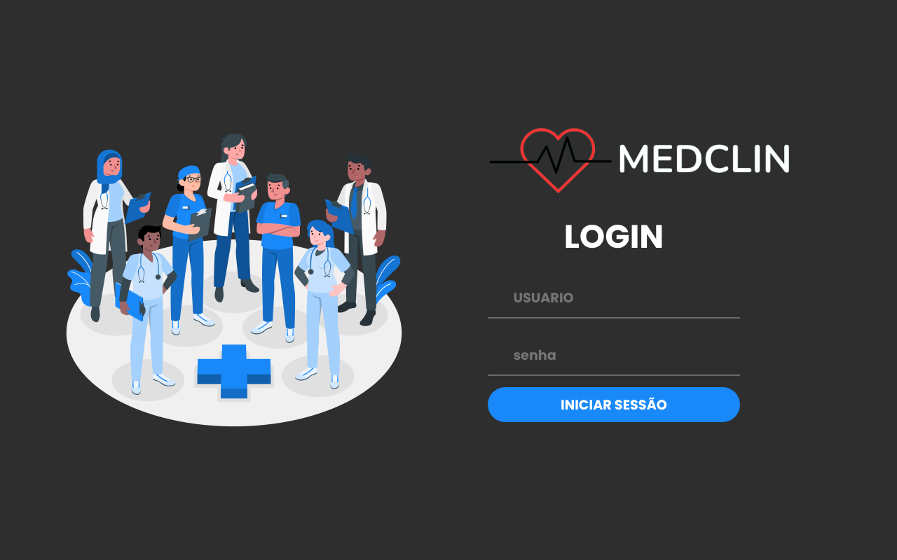
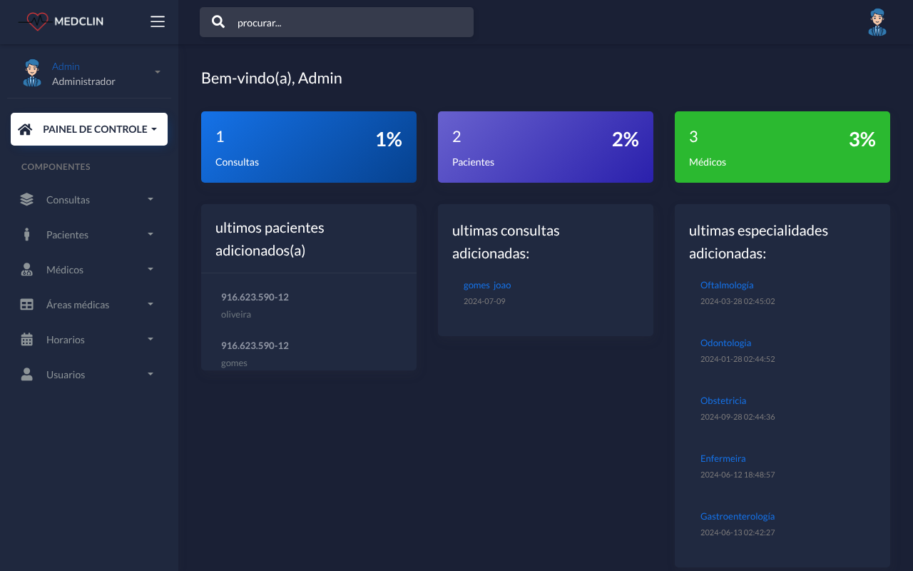
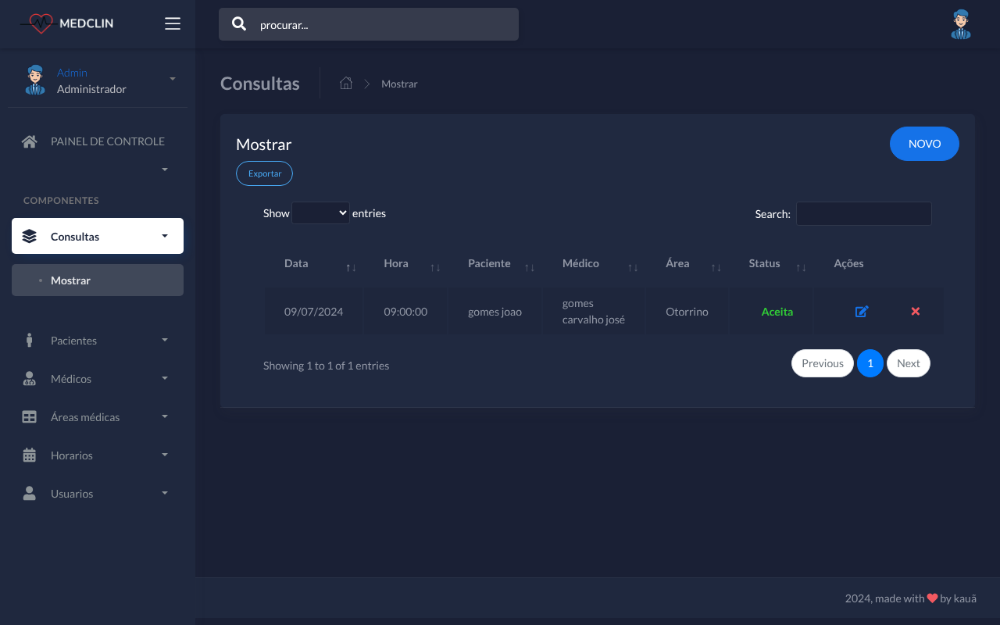
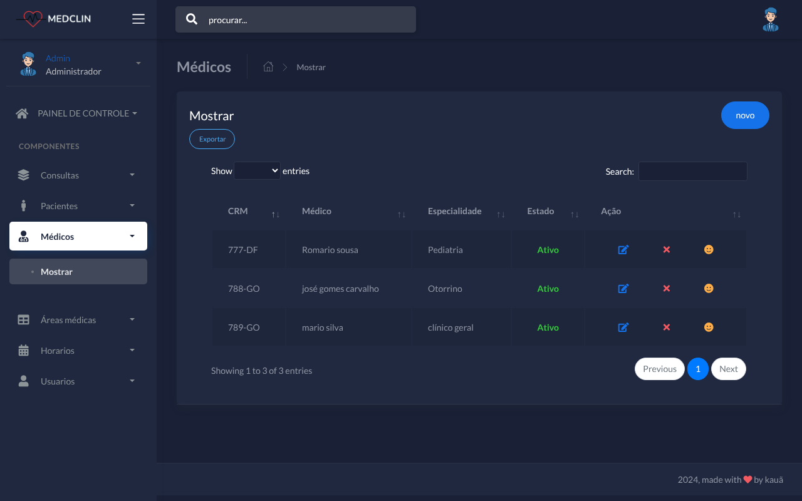
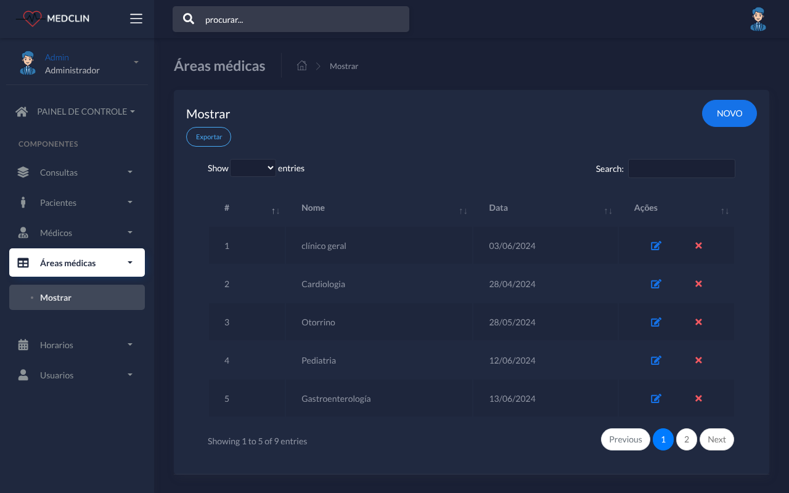
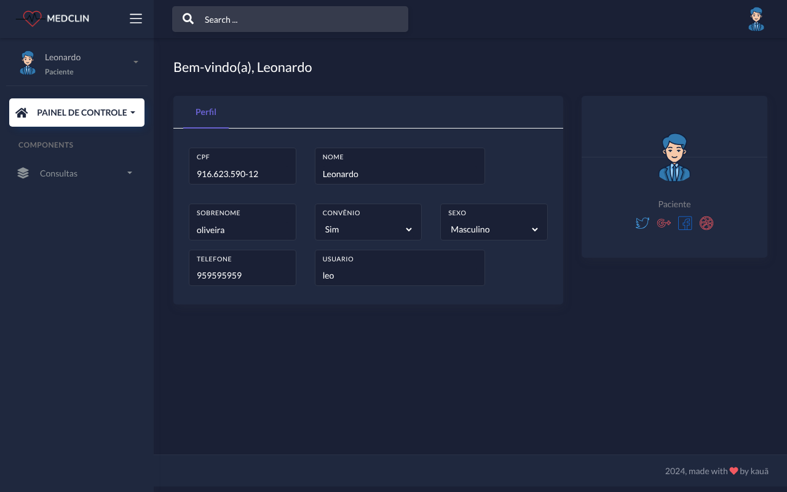

<p align="center">
  
</p>

<h1 align="center">🏥 MedClin — Sistema de Gestão Clínica</h1>

<p align="center">
  Sistema web em <b>PHP</b> e <b>MySQL</b> para organizar o dia a dia de clínicas e consultórios: agendamento de
  <b>consultas</b>, cadastro de <b>pacientes</b>, <b>médicos</b>, <b>especialidades</b> e <b>horários</b>, com
  relatórios em <b>PDF</b>.
</p>

<p align="center">
  
  
  
  
  
</p>

<p align="center">
  <a href="#-sobre-o-projeto">Sobre</a> •
  <a href="#-funcionalidades">Funcionalidades</a> •
  <a href="#️-telas">Telas</a> •
  <a href="#-como-executar">Como executar</a> •
  <a href="#-estrutura-do-projeto">Estrutura</a> •
  <a href="#️-tecnologias">Tecnologias</a>
</p>

---

## 📌 Sobre o projeto

> **PCC (Projeto Complementar de Curso)** desenvolvido para as disciplinas de Linguagem de Programação II e Design Web.

O **MedClin** organiza o fluxo de trabalho de clínicas e consultórios. O foco central é o agendamento de consultas e
o gerenciamento centralizado dos dados de pacientes e profissionais de saúde.

O sistema tem perfis de acesso diferentes, definidos pelo campo `cargo` no banco:

* **🏢 Administrador:** gestão completa de consultas, pacientes, médicos, áreas médicas, horários e usuários, com
  exportação de relatórios.
* **📍 Paciente:** acessa o próprio perfil e a lista das suas consultas.
* **🩺 Recepção:** perfil previsto no banco (cargo `3`), ainda sem painel próprio no login.

### Organização em camadas

Embora o projeto esteja em um único repositório (monolito), ele segue uma divisão clara de responsabilidades:

* **Front-end (`frontend/`):** camada de apresentação organizada **por domínio**, com uma pasta para cada parte do
  negócio (`citas`, `medicos`, `pacientes`, `horarios`, `especialidad`, `usuarios`).
* **Back-end (`backend/php`, `backend/db`, `backend/modal`):** scripts PHP de inclusão, alteração e exclusão,
  conexão com o banco via **PDO** e os formulários em modal.
* **Recursos (`backend/css`, `backend/js`, `backend/fonts`, `backend/img`, `backend/fpdf`):** estilos, scripts,
  fontes, imagens e bibliotecas de terceiros.

## ✨ Funcionalidades

| | Recurso | Descrição |
|---|---|---|
| 🔐 | **Login com perfis** | Administrador e paciente são levados a painéis diferentes |
| 📊 | **Painel de controle** | Totais de consultas, pacientes e médicos e os últimos cadastros |
| 📅 | **Consultas** | Agendar, editar, excluir e listar consultas com data, hora, médico, área e status |
| 👥 | **Pacientes** | CRUD com CPF, telefone, convênio e usuário de acesso |
| 🩺 | **Médicos** | CRUD com CRM, especialidade, contato e situação (ativo/inativo) |
| 🗂️ | **Áreas médicas** | Cadastro das especialidades atendidas pela clínica |
| 🕒 | **Horários** | Cadastro dos horários de atendimento |
| 👤 | **Usuários e perfil** | Gestão de usuários do sistema, edição do perfil e troca de senha |
| 📄 | **Relatórios em PDF** | Exportação de pacientes, médicos, áreas médicas, horários e usuários com **FPDF** |
| 🔎 | **Listagens** | Busca, ordenação e paginação com **DataTables** e confirmações com **SweetAlert** |

## 🖼️ Telas

<table>
  <tr>
    <td align="center"><b>Login</b><br></td>
    <td align="center"><b>Painel do administrador</b><br></td>
  </tr>
  <tr>
    <td align="center"><b>Consultas</b><br></td>
    <td align="center"><b>Médicos</b><br></td>
  </tr>
  <tr>
    <td align="center"><b>Áreas médicas</b><br></td>
    <td align="center"><b>Painel do paciente</b><br></td>
  </tr>
</table>

## 🚀 Como executar

### Opção 1: Docker Compose

O repositório traz um `Dockerfile` (PHP 7.4 + Apache) e um `docker-compose.yml` que sobe o MySQL 5.7 e importa
`medclin_projeto/backend/db/medclin.sql` automaticamente.

```bash
git clone https://github.com/kauaxp77/Medclin.git
cd Medclin
docker compose up -d
```

Acesse `http://localhost` (a página inicial redireciona para o login).

### Opção 2: XAMPP

1. Inicie o **Apache** e o **MySQL** no painel do XAMPP.
2. Copie a pasta `medclin_projeto` para o `htdocs` (ex.: `C:\xampp\htdocs\medclin_projeto`).
3. No phpMyAdmin (`http://localhost/phpmyadmin`), crie o banco **`medclin`** e importe
   `medclin_projeto/backend/db/medclin.sql`.
4. Acesse `http://localhost/medclin_projeto`.

A conexão fica em `backend/db/config.php` e lê as variáveis `DB_HOST`, `DB_USER`, `DB_PASS` e `DB_NAME`
(padrão: `localhost`, `root`, senha vazia, `medclin`).

### Opção 3: servidor embutido do PHP

```bash
mysql -u root -e "CREATE DATABASE medclin"
mysql -u root medclin < medclin_projeto/backend/db/medclin.sql
cd medclin_projeto
php -S localhost:8000
```

Acesse `http://localhost:8000`.

### Usuários de teste

Estão no arquivo [`medclin_projeto/login.txt`](medclin_projeto/login.txt) (senha `123` para todos):

| Perfil | Usuário |
|---|---|
| Administrador | `admin01` |
| Paciente | `leo` ou `joao` |

## 📁 Estrutura do projeto

```
Medclin/
├── medclin_projeto/
│   ├── index.php               # Redireciona para o login
│   ├── login.txt               # Usuários de teste
│   ├── frontend/
│   │   ├── login.php / salir.php
│   │   ├── administrador/      # Painel do administrador
│   │   ├── administrador_user/ # Painel e consultas do paciente
│   │   ├── citas/              # Consultas
│   │   ├── pacientes/          # Pacientes (+ relatório PDF)
│   │   ├── medicos/            # Médicos (+ relatório PDF)
│   │   ├── especialidad/       # Áreas médicas (+ relatório PDF)
│   │   ├── horarios/           # Horários (+ relatório PDF)
│   │   ├── usuarios/           # Usuários e troca de senha (+ relatório PDF)
│   │   ├── profile/            # Perfil do usuário logado
│   │   └── funciones/          # Consultas auxiliares para os formulários
│   └── backend/
│       ├── db/                 # config.php, medclin.sql, MEDCLIN_RESERVA.sql e modelo (mer.mwb)
│       ├── php/                # Inclusão, alteração, exclusão e login
│       ├── modal/              # Formulários de cadastro em modal
│       ├── fpdf/               # Biblioteca FPDF
│       └── css/ js/ fonts/ img/
├── docs/                       # Banner e capturas de tela deste README
├── Dockerfile
└── docker-compose.yml
```

## 🛠️ Tecnologias

* **Back-end:** PHP 7.4+ com PDO
* **Banco de dados:** MySQL
* **Front-end:** HTML5, CSS3, JavaScript, jQuery e o template administrativo **Atlantis** (Bootstrap)
* **Bibliotecas:** DataTables, SweetAlert, FPDF, FontAwesome e Flaticon
* **Ambiente:** XAMPP ou Docker (PHP 7.4 + Apache e MySQL 5.7)

### Ferramentas de desenvolvimento

* **IDE:** Visual Studio Code
* **Servidor local:** XAMPP
* **Gestão de BD:** phpMyAdmin e MySQL Workbench
* **Modelagem:** Astah
* **Versionamento:** Git e GitHub

## 👨‍💻 Autor

Desenvolvido por **[kauaxp77](https://github.com/kauaxp77)**

<p align="center">⭐ Se curtiu o projeto, deixe uma estrela!</p>
